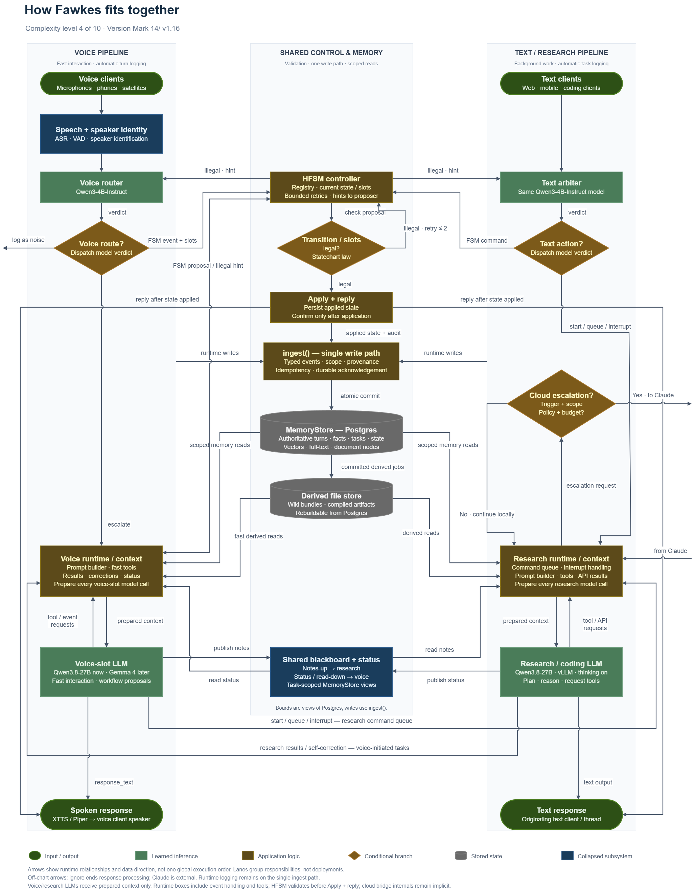
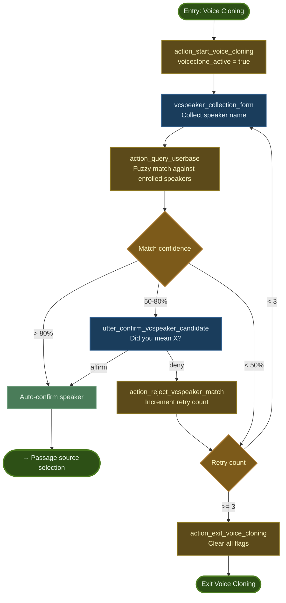

# Fawkes

**A self-hosted, voice-native, multi-user AI assistant with a memory that never forgets and always cites its sources.**

Fawkes runs entirely on local hardware. It listens on any microphone, knows who is speaking, remembers every conversation verbatim with timestamps, and reasons over that memory with a hierarchical statechart driving a local large language model. It is built around one conviction: an assistant is only as good as its memory, and memory is an architecture, not a feature.

---

## What Fawkes is

- **Voice-first.** On-device wake word on every microphone, streaming speech recognition, voice-activity detection, continuous speaker identification, and cloned-voice synthesis, end to end, on owned GPUs.
- **Person-centric.** Memory is keyed to the *speaker*, resolved from voice (ECAPA-TDNN embeddings accumulated per conversation), across every session and device, never to a chat session. Multiple users are a hard requirement at every stage.
- **Memory-first.** A PostgreSQL system of record holds verbatim, timestamped transcripts and a bi-temporal facts table (when a fact was true, when it was learned), with hybrid lexical and semantic retrieval inside the same transactional boundary. Summaries and compiled knowledge are overlays that link back to sources and never replace them.
- **Scoped by trust.** Every record lives in exactly one of three areas — a shared household *workspace*, a private *user* area, or a hardened *silo* — and each area has its own level of authentication: registered-device trust, voice authentication by reading a pushed passage aloud, or web sign-in plus a PIN. Authorization is checked per utterance, never granted to a device for a whole session.
- **Statechart-driven.** Multi-step workflows (enrollment, voice cloning, authentication) are Harel statecharts. The language model *proposes* transitions; a deterministic validator *ratifies* them. No closed-set intent classifier ever gates the conversation.
- **Two pipelines, one brain.** A latency-critical voice loop (deterministic lookups and single-shot tools only) runs alongside a research and coding pipeline (agentic retrieval, multi-hop reasoning, document trees, a compiled wiki), with a shared blackboard and a command queue between them.
- **Local by default.** Everything runs on the workstation; a cloud model is called only as a per-request subagent, under a policy with a budget, with extracted text rather than documents, and every remote turn is stored locally.

## Architecture



*Level 4 of 10 on the project's complexity scale, drawn from Architecture Specification v1.16. Source: [`docs/diagrams/architecture_L4_v1.16.drawio`](docs/diagrams/architecture_L4_v1.16.drawio). Notation: [`docs/Fawkes_Diagram_Standards.md`](docs/Fawkes_Diagram_Standards.md).*

Three lanes. The **voice pipeline** turns microphones into a router verdict (ignore, statechart event, or escalate) and, on escalation, a prompt assembled by deterministic code from tiered memory layers before the voice-slot model answers. The **text and research pipeline** does the same for web, mobile, and coding clients, with an arbiter deciding whether a message starts, queues, or interrupts background work, and a governed bridge deciding whether a task escalates to a cloud model. Between them, **shared control and memory**: the statechart controller validates every proposed state change against statechart law before anything is applied or spoken; `ingest()` is the single write path into Postgres; both pipelines read memory through scoped, eligibility-checked queries; and a blackboard carries notes up from voice, status down from research, and commands straight to the research queue.

### Workflow depth: one excerpt

Every multi-step flow is specified as a diagram before it is coded. The excerpt below is the speaker-selection stage of the voice-cloning workflow from Iteration 1: fuzzy-match confidence decides whether the system auto-confirms, asks, or retries, and three failed retries abort cleanly.



The complete Iteration-1 flowcharts (enrollment name collection with spelling confirmation, pangram recording, and the full voice-cloning loop) are in [`docs/diagrams/iteration1/`](docs/diagrams/iteration1/); earlier drafts are in [`docs/diagrams/iteration1/archive/`](docs/diagrams/iteration1/archive/). Iteration-2 statecharts are added under `docs/diagrams/iteration2/` as `stateDiagram-v2` sources alongside the code that implements them.

## Design principles (abridged)

1. One ACID system of record; everything else is derived and rebuildable.
2. Verbatim first; synthesis is an overlay with provenance.
3. Time is not optional: every turn, fact, and resource is timestamped, and elapsed time is injected into every prompt.
4. One write path (`ingest()`): typed, idempotent, provenance-stamped, durably acknowledged.
5. Transformations leave receipts: manifests on compression, traces on retrieval, cost on every model call.
6. Epistemic hygiene: cite the source, or say "I don't know."
7. Latency class determines retrieval class: the voice loop never waits on an LLM-driven search.
8. The LLM proposes; deterministic code ratifies.
9. Authorization precedes ranking: eligibility decides what may be read; relevance weights rank only what is eligible.
10. Adopt at the edges, build the core: the statechart, memory substrate, and identity system are built; coding harnesses and serving runtimes are adopted behind seams.
11. Measure, don't debate: an evaluation harness is a component of the system.

The complete manifesto is [`docs/Fawkes_Guiding_Principles.md`](docs/Fawkes_Guiding_Principles.md). The rest of the design set lives beside it: [architecture specification](docs/Fawkes_Architecture_Specification.md), [behavior contract](docs/Fawkes_Behavior_Contract.md), [implementation plan](docs/Fawkes_Implementation_Plan.md), [systems inventory](docs/Fawkes_Systems_Inventory.md), [wishlist](docs/Fawkes_Wishlist.md), [toolbox](docs/Fawkes_Toolbox.md), [diagram standards](docs/Fawkes_Diagram_Standards.md), and [session handoff](docs/Fawkes_Session_Handoff.md).

## Technical highlights from Iteration 1

- Domain-size-adaptive speaker confidence scoring: the similarity-gap weight scales inversely with the number of enrolled speakers.
- In-memory ECAPA embedding matrix with vectorized cosine similarity for sub-millisecond speaker matching.
- Multi-factor no-match scoring combining utterance duration, domain size, similarity gap, and z-score outlier detection over the full similarity distribution.
- Cumulative incremental voice imprints: enrollment embeddings are duration-weighted averages over multiple samples with tracked sample counts.
- Retroactive transcript editing (`retroedit_id`) for in-place correction of streamed words as final transcription lands.
- Intent-agnostic, context-aware slot capture that used rule position rather than intent classification to route enrollment steps around NLU unreliability.
- Sequential TTS queue with input muting until the outgoing queue drains, preventing the assistant from transcribing its own voice.

## Stack

| Layer | Technology |
|---|---|
| Speech | NVIDIA NeMo (FastConformer, Canary-Qwen, MarbleNet) behind a typed streaming interface; ECAPA-TDNN; XTTS / Piper; ESP32-S3 satellites with hardware audio front ends |
| Cognition | Qwen3.8-27B (Int4) on vLLM and a Qwen3-4B router on llama.cpp, sharing one RTX 3090; hierarchical statechart + validator |
| Memory | PostgreSQL + pgvector + full-text search; bi-temporal facts; hybrid retrieval with Reciprocal Rank Fusion; scope on every row |
| Research / coding | Agentic retrieval loop, PageIndex-style document trees, OKF-conformant wiki, code-graph MCP servers, OpenCode, MCP server over MemoryStore |
| Infrastructure | Docker Compose, FastAPI, asyncio, GitHub Actions CI, pytest eval harness |

## How it is being built

Iteration 2 is developed in graded rounds. For each round the planning seat writes a spec and commits its tests first; two implementers from different model vendors build the same spec in separate git worktrees; a grader audits each implementation's claims against its diff before scoring; and the owner integrates the winner only after explaining its functions in a viva. The process, contract, grader prompt, and round list are in [`buildout/`](buildout/); every round's documents are archived there and never deleted.

## Implementation status

**Iteration 1 — Rasa-based voice assistant (complete, frozen)**
- [x] Streaming ASR with interim and final transcription (FastConformer interim, Canary-Qwen final)
- [x] Voice-activity detection and endpointing (MarbleNet)
- [x] Speaker enrollment and identification (ECAPA-TDNN, incremental imprints)
- [x] Voice cloning (XTTS conditioning latents, Piper fallback)
- [x] Multi-client WebSocket server with class-based architecture (`canary/server03f.py`)
- [x] Rasa-driven enrollment and voice-cloning workflows with fuzzy-matched name and passage selection
- [x] DuckDB speaker, pangram, and passage store

**Iteration 2 — LLM + statechart rebuild (in progress; rounds per [`buildout/ROUNDS.md`](buildout/ROUNDS.md))**

- [ ] **Phase 0 — Milestone Zero** (first running code)
  - [ ] P0-1 Postgres + pgvector service; migration 001 with workspaces, silos, scoped projects, devices and environments, transcripts with runtime event ids, bi-temporal facts, documents and document nodes, derived jobs, pending deliveries, tunnels; scope pair on every content row, identity tables outside it; audio-capture columns reserved; no raw audio ever stored
  - [ ] P0-2 Typed `ingest()`: event-id idempotency for turns, content hash per scope for documents, search vector committed with the row, derived job in the same transaction, acknowledgement after commit; `remember_utterance()` delegates from day one
  - [ ] P0-3 `recall()`: eligibility first, then Postgres full-text ranking + vectors with Reciprocal Rank Fusion; the permanent Phase 0 suite (duplicate-utterance and retry, crash between commit and embedding, silo leakage through every path, restart survival); CI bootstrap
- [ ] **Phase 1 — Cognitive core and substrate foundation** (text mode; Iteration 1 keeps running)
  - [ ] P1-1 Structured-output contract and validator: all-or-nothing ratification, two bounded retries, confirmation only after application; shared `FakeLLM` fixture
  - [ ] P1-2 Statechart registry: workflow state keyed by user, scope, and instance; version checks; append-only applied-state history
  - [ ] P1-3 Prompt builder, Layers 0-1 and the topic slice: deterministic assembly after the router verdict, local and elapsed time, scope assertion on every item
  - [ ] P1-4 Small-model router v1 (statechart event / ignore / escalate with confidence) in front of the 27B
  - [ ] P1-5 Ontology v1 as enum tables and constraints; `ingest()` fan-out registry; one JSON trace per turn and model call; capability-card and feedback-event schemas; Postgres backup
  - [ ] P1-6 Serving: vLLM for the 27B and llama.cpp for the 4B on the same card, OpenAI-compatible seam, cache-stable prefix; serving-recipe experiment and Budget A measured
  - [ ] P1-7 Eval harness v0 (about 30 seeded cases by slice, nightly smoke, weekly full runs, prove-it-bites meta-test); first capability cards; Phase 1 exit
- [ ] **Phase 2 — Voice memory and identity** (voice becomes primary; Rasa retired)
  - [ ] P2-1 Speech behind typed seams (raw and enhanced audio per consumer; opaque per-stream ASR state); capture statistics and an embedding stored per voice turn; DuckDB migrated into Postgres and retired
  - [ ] P2-2 Per-conversation speaker accumulator with online clustering and prior-aware matching
  - [ ] P2-3 Wake word, microphone election, session and follow-up windows, listen-along binding, continuity judge
  - [ ] P2-4 Enrollment and voice-clone statecharts ported (enrollment creates an identity with consent; no passphrase)
  - [ ] P2-5 Pass-blurb authentication (a pushed passage read aloud, with a full challenge protocol), per-utterance authorization, Layer 1a/1b disclosure, threshold revocation, audit
  - [ ] P2-6 Thread promotion to a user area as a unit, mixed-speaker rules, private-continuation forks
  - [ ] P2-7 Tiered context on the voice path; semantic cache keyed by permission set
  - [ ] P2-8 Fast-class tool registry in a sandbox, voice register, correction and memory-promotion hooks
  - [ ] P2-9 Session-end imprint enrichment with a maturity-aware gate, authenticated sessions as ground truth, drift monitor, versioned rollback
  - [ ] P2-10 Speaker-identification evaluation slice, real satellite integration, Rasa switched off; two speakers hold personalized conversations on separate devices
  - [ ] P2-11 (conditional) Multi-centroid imprints, only if the evaluation slice shows an environment failing
- [ ] **Phase 3 — Ingestion, research pipeline, external hands, dual-pipeline interplay**
  - [ ] P3-1 Ingestion adapters and router with OCR; PageIndex-style document trees with checksum caching
  - [ ] P3-2 Research pipeline v1: agentic loop, CRAG grading, recall ladder with citations, checkpoints
  - [ ] P3-3 Text arbiter (start / queue / interrupt / statechart command), one disposition per message, generation-scoped cancellation
  - [ ] P3-4 Rubber-duck interplay: blackboard, status projection, imperatives, results back to voice
  - [ ] P3-5 Durable delivery: claims and acknowledgements, assurance re-checked at playback, preferred-device push
  - [ ] P3-6 Code tools, code-graph MCP servers, OpenCode, scoped MCP server over `MemoryStore`
  - [ ] P3-7 Governed cloud escalation with per-call budget reservation and local logging of every remote turn
  - [ ] P3-8 Non-destructive compaction with manifests, idle-window scheduler, salience v1, contradiction detector v1
  - [ ] P3-9 Coding-patch evaluation slice; Phase 3 exit
  - [ ] P3-10 (conditional, ~3.5) State-space-model ASR substituted behind the typed interface when the audio evidence gate opens
- [ ] **Phase 4 — Synthesis layer, second GPU, measured experiments**
  - [ ] P4-1 OKF-conformant wiki distillation with lifecycle states, lint, and source descent
  - [ ] P4-2 Tunnel lifecycle within a scope instance; contradiction escalation to a clarification statechart
  - [ ] P4-3 Gemma 4 on a second RTX 3090 as the voice-slot model; listening tests against tuned Qwen
  - [ ] P4-4 Panel mode with arbiter strategies and recorded verdicts
  - [ ] P4-5 Heads-down mode, reconciliation crons, the four recorded benchmarks
- [ ] **Phase 5 — Web interface, multi-surface, back-catalog**
  - [ ] P5-1 Web app: chat, uploads, projects, sign-in and sessions, hardening pass
  - [ ] P5-2 Row-level security per user; silo area with PIN after sign-in, device-exclusive sessions, separate timeouts (P5-2a: Tier B silo enforcement, only if a second silo is wanted)
  - [ ] P5-3 Workspace administrator and root roles; voice-approved device pairing; revocation and audit views
  - [ ] P5-4 Workspace conversation list and per-thread actions (archive, export, duplicate, move to profile); preferred-device registration
  - [ ] P5-5 Back-catalog import of Iteration-1 logs and Claude/ChatGPT exports; authorized cross-silo export; mobile API; handoff bundles
- [ ] **Phase 6+ — Frontier** (planned, not scheduled): browser and terminal capture, screen context, digests and scrape crons, home automation, computer vision, Graphiti if bi-temporal SQL hits its ceiling

## Research directions

- **Speaker separation ("cocktail party")**: a separate research track and repository, trained and evaluated on prepared public datasets; results will feed Fawkes's speech stack through the typed ASR interface.
- **State-space-model ASR**: replacing transformer ASR with Mamba-class streaming models for constant-memory, low-latency transcription.
- **Microphone and environment quality**: per-device and per-environment identification reliability from the capture statistics Fawkes already records; multi-centroid voiceprints if the evidence calls for them.
- **Retrieval policy**: measured comparisons of compiled-wiki, hypergraph, and agentic retrieval on a personal research corpus.

## Getting started

Requirements: Docker with the NVIDIA container toolkit, one CUDA-capable GPU (developed on a single RTX 3090), a host directory `~/fawkes` holding model weights (`models/coqui_xtts/XTTS-v2/`, `models/ecapa_tdnn_embed/ecapa_tdnn.nemo`) and audio samples (mounted into the container at `/root/fawkes`), and a sibling directory `../fawkes_private/` outside the repository holding the speaker database (`speakers/database.duckdb`) and the Postgres secrets (`secrets/pg_password.txt`, `secrets/pg_url.txt`), mounted at `/workspace-private` and `/run/secrets`.

```bash
docker compose up -d                       # postgres, fawkes (Iteration 2); canary, rasa-nlp, rasa-actions (Iteration 1)
docker compose exec canary python3 server03f.py      # Iteration-1 voice server
docker compose exec fawkes pytest                     # Iteration-2 test suite
```

The voice server listens for WebSocket clients on port 9001 and serves its HTTP API on 9002; Postgres is on 5432; the companion browser client lives in the `fawkes-frontend` repository. Two Dev Containers configurations are provided: `fawkes` for Iteration-2 work and `canary` for the Iteration-1 server; both open the repository root as `/workspace`.

Rasa maintenance:

```bash
docker compose exec rasa-nlp rasa train --force --debug          # retrain after editing legacy/iteration1/rasa-nlp/
docker restart rasa-nlp rasa-actions                            # reload the trained model
docker compose exec rasa-nlp rasa shell --port 5007 --debug     # interactive test shell
docker logs -f rasa-nlp                                         # follow logs
docker compose up -d --force-recreate --no-deps --build rasa-nlp   # rebuild one service
```

Operational notes:

- Rasa's training cache runs on a tmpfs ramdisk (see `docker-compose.yml`); SQLite's atomic writes do not survive Docker volumes bridging the Windows virtualization layer.
- If Docker is shut down uncleanly, `rm .git/index.lock` may be needed before git works again.
- Docker "rebuild" can silently reuse a cached broken image; `docker system prune -a` forces a genuine rebuild.
- `watch -n 1 nvidia-smi` tracks GPU memory live.

## Repository layout

| Path | Contents |
|---|---|
| `src/fawkes/` | Iteration-2 package: `speech/`, `memory/`, `cognition/` (with `fsm/`), `server/`, `eval/`. Scaffolded; Phase 0 lands in `memory/` |
| `migrations/` | Plain-SQL schema migrations, applied in order |
| `tests/` | `unit/`, `integration/` (live Postgres), `functional/` (statechart walkthroughs against a mock model); phase exits are permanent markers; round tests are committed before their round opens |
| `docs/` | The nine living design documents; `docs/diagrams/` holds the architecture overview (`architecture_L4_v1.16.*`) and the workflow flowcharts |
| `buildout/` | The development pipeline: process, implementer contract, grader prompt, round list, and every round's archived documents |
| `tools/` | `round.py` — round bookkeeping (timing, diff hashing, spec-test guard) |
| `infra/` | `docker/fawkes.Dockerfile`, `postgres/init.sql` |
| `docker-compose.yml`, `.devcontainer/` | `postgres`, `fawkes`, and the Iteration-1 services on one network; Dev Containers configs for `fawkes` and `canary` |
| `legacy/iteration1/` | The frozen Iteration-1 system: `canary/` (voice server, speaker tooling, earlier code generations), `rasa-nlp/`, `rasa-actions/` |

## License

Not yet chosen. All rights reserved until a license file is added.
